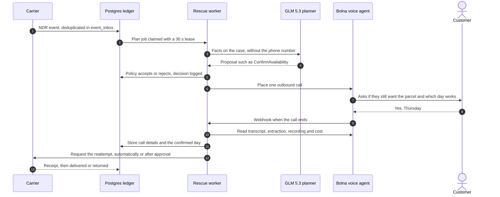
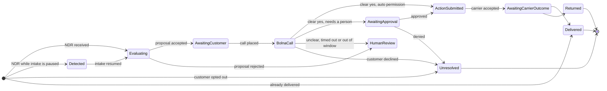
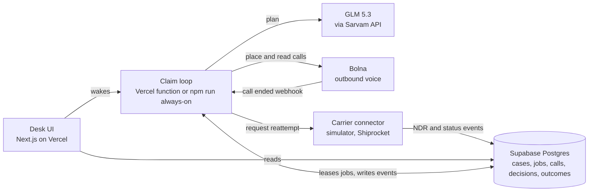

# Rescue

Rescue is an always-on agent for failed cash-on-delivery parcels in India. When a courier cannot hand over a parcel, Rescue phones the customer with a Bolna voice agent, asks which day they will be home, and requests a second delivery attempt once the customer clearly says yes. Every step is written to a Postgres ledger, so the work survives restarts and can be audited later.

Live desk: https://delivery-rescue-os.vercel.app

Built with [Bolna](https://www.bolna.ai) for outbound voice, GLM 5.3 for planning, Supabase Postgres as the ledger, Next.js on Vercel for the desk, and [Effect](https://effect.website) for the worker.

## The problem

Cash on delivery is how a large share of Indian e-commerce orders are paid for. When a COD delivery fails, the courier files a non-delivery report (NDR) and the order waits in a queue. If nobody reaches the customer before the reattempt window closes, the parcel is sent back to the seller. The seller pays shipping in both directions and loses the sale, even when the customer still wanted the parcel and was simply out that afternoon.

Rescue closes that gap with a phone call on the day of the failure.

## How it works



The planner proposes one next step: call the customer, stay silent, or hand the case to a person. It only sees facts already on the case and must cite them as evidence. The domain reducer accepts a proposal only when that evidence checks out and the customer has consented to calls. A rejected proposal sends the case to human review.

The voice agent, Asha, asks one question at a time, reads the chosen day back, and counts only an explicit yes to that read-back as confirmation. It does not claim that a booking was made, and it never asks for payment details, OTPs or addresses. The prompt and extraction schema are in `scripts/configure-bolna.mjs`.

## Case lifecycle

Every case moves through the same phases. The reducer in `packages/domain/src/reduce.ts` is the only code that decides a transition.



Human review carries a reason, such as `call_unclear`, `call_timeout`, `model_invalid` or `date_out_of_window`, and the desk marks those cases in orange. A completed call does not count as proof of delivery. Only a carrier outcome closes a case as delivered.

## Architecture



Work is stored as rows in `workflow_jobs`. A process claims a job through `claim_job`, which grants a 30-second lease and allows up to five attempts. If a process dies mid-job, another one picks the job up when the lease expires. Each case has a version number that every update checks, so two workers cannot advance the same case.

The same claim loop runs in two places. On Vercel, opening the desk, seeding a case and the Bolna webhook each wake the worker for one invocation, and a daily cron calls `/api/worker` as a backstop. On any machine, `npm run always-on` keeps a resident worker running and restarts it within a second if it exits.

Integrations are connectors grouped by kind: logistics, voice, AI, notifications and commerce. Each organization has one active connection per kind in `provider_connections`, with encrypted credentials and a permission of `auto`, `require_human` or `deny` for each action. The case logic does not reference a specific carrier.

## Repository layout

```
apps/
  web/          Next.js desk, landing page and API routes
  worker/       Entry point for the resident worker
packages/
  domain/       Pure reducer from (case, event) to next phase and row writes, with tests
  harness/      Claim loop, leases, retries, and the plan, call, poll and submit jobs
  connectors/   GLM 5.3 planner, Bolna calls and execution reads, connector registry
  shared/       Event and proposal schemas, credential encryption
supabase/
  migrations/   Ledger schema, job claiming, public views, call details
scripts/
  always-on.mjs        Supervisor that restarts the worker
  configure-bolna.mjs  Pushes the Asha prompt, voice and extraction schema to Bolna
```

## The desk

| Page | What it shows |
| --- | --- |
| Overview | Open cases, cash at stake, calls placed, cases waiting on a person, recent planner decisions and eight-day throughput |
| Queue | Open and recently closed cases, each drawn on its route through the six stages |
| Shipment | One case in full: call status, duration, cost, summary, recording, extracted answers, transcript, timeline, decisions, actions and jobs |
| Approvals | Carrier actions that policy held for a person |
| Agent | Worker heartbeat, with controls to pause or resume intake |
| Integrations | Connector status, read only |
| Outcomes | Closed cases grouped by result and source |

## Privacy and safety

Phone numbers are encrypted with `CREDENTIALS_KEY` before they are stored, and the desk shows only a masked number. The planner prompt never contains the number. Bolna and model API keys stay in server environment variables; they are not sent to the model or rendered in the UI. Worker logs mask bearer tokens. A customer marked `opted_out` is closed as unresolved without a call.

## Running it locally

You need Node 22 or later, a Supabase project, a Bolna account with an agent, and a Sarvam API key for GLM 5.3.

```bash
npm install
cp .env.example .env
```

| Variable | Purpose |
| --- | --- |
| `DATABASE_URL` | Supabase pooler URL (IPv4) for the `rescue_worker` role |
| `CREDENTIALS_KEY` | 32 random bytes, base64: `node -e "console.log(require('crypto').randomBytes(32).toString('base64'))"` |
| `WORKER_ID` | Unique name for each worker process |
| `BOLNA_API_KEY`, `BOLNA_AGENT_ID` | Bolna credentials and the agent that places calls |
| `BOLNA_WEBHOOK_SECRET` | Compared against the `x-bolna-secret` header on webhook calls |
| `BOLNA_TEST_PHONE` | Number dialled for seeded test cases |
| `SARVAM_API_KEY`, `SARVAM_BASE_URL` | Access to the GLM 5.3 planner (`glm5.3-flash`) |
| `DEMO_SIMULATOR` | Set to `0` to turn off the simulator carrier routes |

Apply the migrations in `supabase/migrations/` in order, then run:

```bash
node scripts/configure-bolna.mjs   # once: pushes the Asha prompt and extraction schema
npm run always-on                  # resident worker
npm run dev:web                    # desk at http://localhost:3000
```

## Development

```bash
npm test           # domain reducer and connector tests
npm run typecheck  # all workspaces
```

The reducer is pure: given a case snapshot and an event, it returns the next phase and the exact rows to write. The harness is the only package that touches the network or the database. The worker uses the Effect library, so read `AGENTS.md` before changing Effect code.

## Current scope

Calls to customers are real. They go through Bolna, and each call's transcript, recording, summary and cost are stored on the case. Reattempts are submitted to a simulator carrier, and the desk labels those outcomes as simulated. Shiprocket is connected read only, so Rescue does not change live shipments yet. Shiprocket's NDR reattempt action is the next connector to add.
